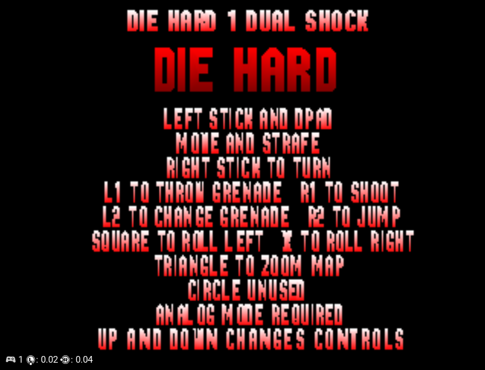

# Die Hard 1 Dual Shock patch

Apply `Die Hard 1 Dual Shock.ppf` to a backup copy of the supported Track 01 BIN
using a PPF3-compatible patcher. Keep the CUE and remaining tracks together.
Boot fresh after patching; an old savestate can restore the previous code.

In the trilogy launcher's Controllers menu, choose Die Hard 1, cycle past
A/B/C to **Dual Shock**, and start Die Hard 1. See the [controls](../README.md#die-hard-1-dual-shock-controls).

**Analog mode is not triggered automatically. Press the Analog button on your
joypad to enable it.** In DuckStation, select Analog Controller and enable
analog mode. The patch recognizes analog input but does not force this mode or
add rumble.

The left stick also navigates menus. Gameplay uses the original movement
speeds with a central stick dead zone; right-stick vertical movement is unused.
Original A/B/C layouts remain available. Die Hard 2 and 3 retain their three
layout choices.

## Corrected controls menu



Button descriptions use **TO** because the original menu font does not support
normal punctuation. The text sits below the game logo without overlapping it.

To upgrade, undo the previous DH1 Dual Shock patch or restore the supported
base image before applying this replacement PPF.

## Tested image

The released patch was built and tested against the local USA v1.1 image,
SLUS-00119, with existing GunCon/DH2 changes. Its Track 01 SHA-256 is:

```text
8c65ce207352e018e842035a15d0a838432eb0c2e242184dd6f106d95632672c
```

This differs from the base documented for the separate DH2 patches. Other
image revisions and patch combinations have not been verified for this release.

Patched Track 01 SHA-256:

```text
6343115d581ab3614b1907ac66086fa989df93a6fd2940803acbf5df4cace09f
```

PPF SHA-256:

```text
6223bc57dac22a096a04b40c5b51881a35660324b5d9b75e6897e040124ada4d
```

The PPF includes undo data. Use your patcher's undo function or restore the
backup to remove it. Only six sectors in the launcher and DH1 executable
changed; all bytes outside those sectors match the tested base. Sector EDC/ECC
and patch application/undo were verified.

4,862 simulated MIPS execution cases passed. The user approved the gameplay
controls and menu/loading behavior in DuckStation. Physical hardware and
saving the layout choice to a memory card have not been tested.
